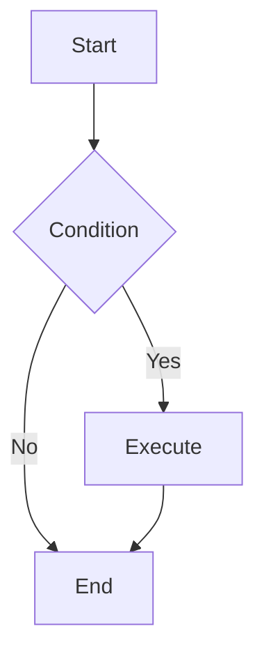

# Mermaid Diagram Generator

Generate high-quality Mermaid diagram code based on user requirements.

## Workflow

1. **Understand Requirements**: Analyze user description to determine the most suitable diagram type
2. **Read Documentation**: Read the corresponding syntax reference for the diagram type
3. **Generate Code**: Generate Mermaid code following the specification
4. **Apply Styling**: Apply appropriate themes and style configurations

## Diagram Type Reference

Select the appropriate diagram type and read the corresponding documentation:

| Type | Documentation | Use Cases |
| ---- | ------------- | --------- |
| Flowchart | [flowchart.md](references/flowchart.md) | Processes, decisions, steps |
| Sequence Diagram | [sequenceDiagram.md](references/sequenceDiagram.md) | Interactions, messaging, API calls |
| Class Diagram | [classDiagram.md](references/classDiagram.md) | Class structure, inheritance, associations |
| State Diagram | [stateDiagram.md](references/stateDiagram.md) | State machines, state transitions |
| ER Diagram | [entityRelationshipDiagram.md](references/entityRelationshipDiagram.md) | Database design, entity relationships |
| Gantt Chart | [gantt.md](references/gantt.md) | Project planning, timelines |
| Pie Chart | [pie.md](references/pie.md) | Proportions, distributions |
| Mindmap | [mindmap.md](references/mindmap.md) | Hierarchical structures, knowledge graphs |
| Timeline | [timeline.md](references/timeline.md) | Historical events, milestones |
| Git Graph | [gitgraph.md](references/gitgraph.md) | Branches, merges, versions |
| Quadrant Chart | [quadrantChart.md](references/quadrantChart.md) | Four-quadrant analysis |
| Requirement Diagram | [requirementDiagram.md](references/requirementDiagram.md) | Requirements traceability |
| C4 Diagram | [c4.md](references/c4.md) | System architecture (C4 model) |
| Sankey Diagram | [sankey.md](references/sankey.md) | Flow, conversions |
| XY Chart | [xyChart.md](references/xyChart.md) | Line charts, bar charts |
| Block Diagram | [block.md](references/block.md) | System components, modules |
| Packet Diagram | [packet.md](references/packet.md) | Network protocols, data structures |
| Kanban | [kanban.md](references/kanban.md) | Task management, workflows |
| Architecture Diagram | [architecture.md](references/architecture.md) | System architecture |
| Radar Chart | [radar.md](references/radar.md) | Multi-dimensional comparison |
| Treemap | [treemap.md](references/treemap.md) | Hierarchical data visualization |
| User Journey | [userJourney.md](references/userJourney.md) | User experience flows |
| ZenUML | [zenuml.md](references/zenuml.md) | Sequence diagrams (code style) |

## Configuration & Themes

- [Theming](references/config-theming.md) - Custom colors and styles
- [Directives](references/config-directives.md) - Diagram-level configuration
- [Layouts](references/config-layouts.md) - Layout direction and spacing
- [Configuration](references/config-configuration.md) - Global settings
- [Math](references/config-math.md) - LaTeX math support

## Rendering with Mermaid CLI

Mermaid CLI is optional when returning diagram source. Use it when the user
requests an SVG, PNG, or PDF export. Save the Mermaid code in `diagram.mmd`
without the Markdown code fences.

Check whether the CLI is already available:

```sh
mmdc --version
```

If installed, render with `mmdc -i diagram.mmd -o diagram.svg`. Change the output
extension to `.png` or `.pdf` for those formats.

If `mmdc` is unavailable, recommend `npx` for occasional exports:

```sh
npx --package @mermaid-js/mermaid-cli mmdc -i diagram.mmd -o diagram.svg
```

For frequent use, recommend a global installation:

```sh
npm install -g @mermaid-js/mermaid-cli
mmdc --version
mmdc -i diagram.mmd -o diagram.svg
```

The current CLI release requires Node.js >=22.13.0 and npm. Check `node --version`
and `npm --version` before recommending installation. Puppeteer downloads a
browser during installation; the first installation or `npx` run needs network
access. Homebrew installation is no longer supported.

Source: [Official Mermaid CLI installation guidance](https://github.com/mermaid-js/mermaid-cli#installation).
Check the [published package requirements](https://www.npmjs.com/package/@mermaid-js/mermaid-cli)
when using a newer release.

## Architecture Diagram Best Practices

When generating `architecture-beta` diagrams, apply these layout techniques for complex diagrams:

### Use Junctions for Layout Control

Think of the diagram as an invisible grid. Use `junction` nodes as virtual anchor points on that grid to precisely control where each component is placed. This is especially useful when a direct edge between two services produces unexpected positioning.

Instead of connecting services directly:

```
lb:R --> L:scim
lb:R --> L:webapi
```

Route through junctions to control vertical/horizontal placement:

```
junction j_lb_r
lb:R -- L:j_lb_r
junction j_scim_l
j_lb_r:T -- B:j_scim_l
j_scim_l:R --> L:scim
junction j_webapi_l
j_lb_r:B -- T:j_webapi_l
j_webapi_l:R --> L:webapi
```

Place junctions on all four sides of components to anchor them logically on the grid.

### Use Edges out of Groups for Floating Components

For services that have no logical connection to other nodes (e.g. a deployment tool, a monitoring agent), use a junction combined with the `{group}` modifier to position them without adding a semantically incorrect edge:

```
junction j_acd_t
j_algolia_proc_b{group}:B -- T:j_acd_t
j_acd_t:B -- T:acd
```

This anchors `acd` below its intended neighbor without implying a real relationship.

## Output Specification

Generated Mermaid code should:

1. Be wrapped in ```mermaid code blocks
2. Have correct syntax that renders directly
3. Have clear structure with proper line breaks and indentation
4. Use semantic node naming
5. Include styling when needed to improve visual appearance
6. Use `<br/>` for line breaks inside node labels — never use `\n`, which renders as literal text

## Example Output



---

Use the diagram description or requirements supplied by the user.
